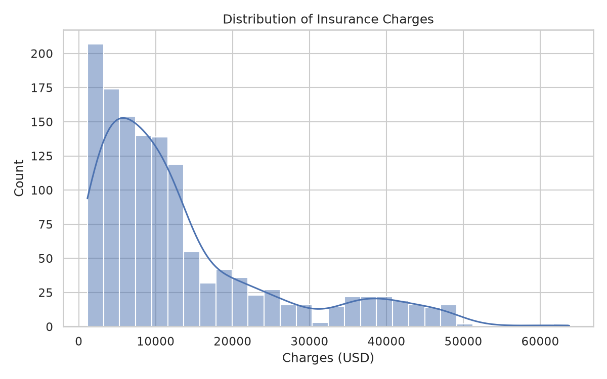
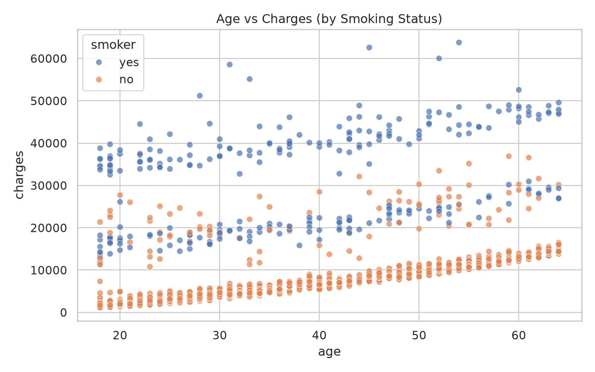
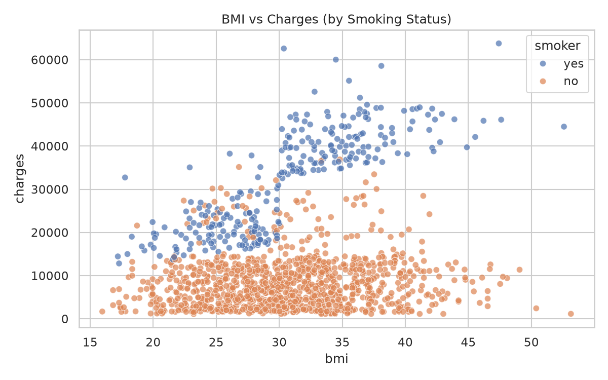
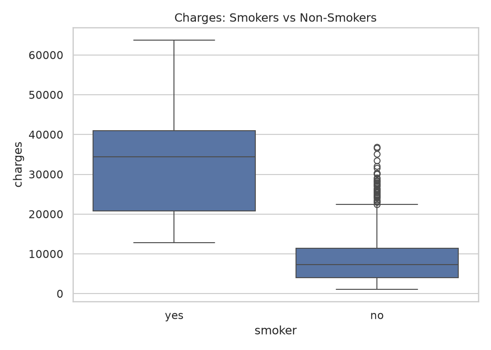
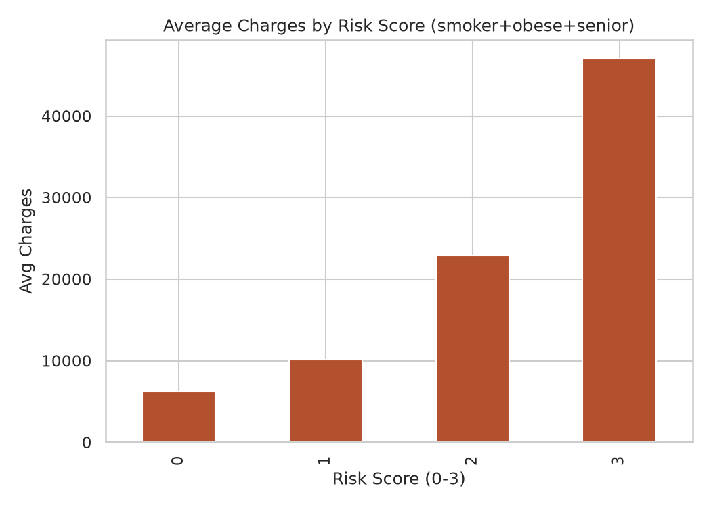
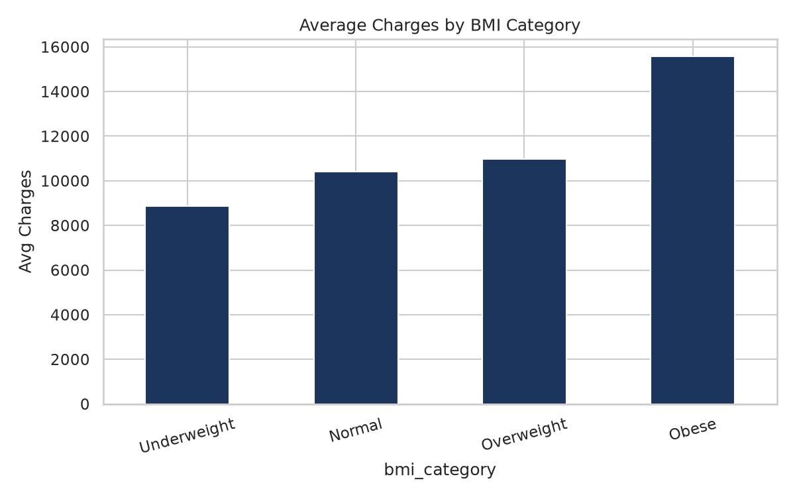
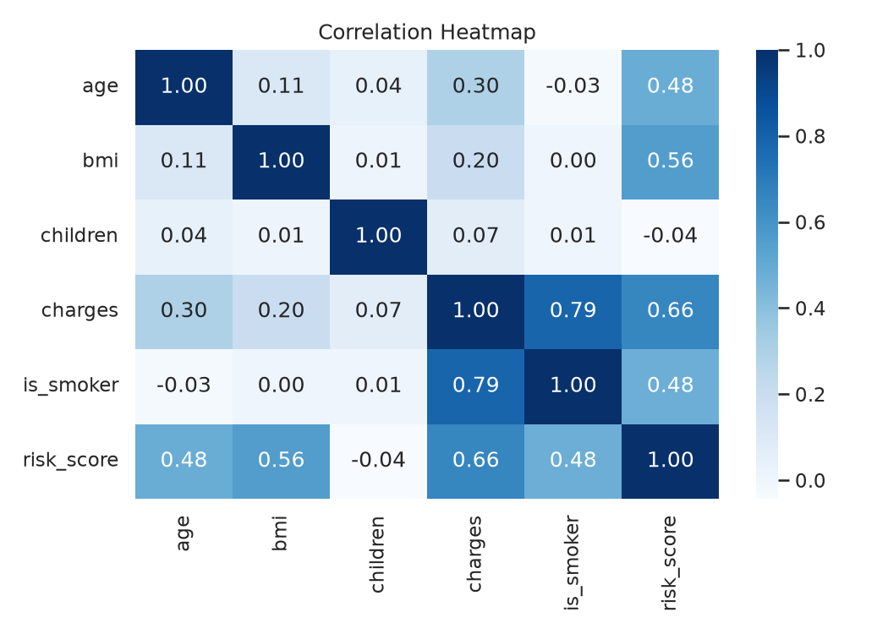

# Health Risk Analyzer — Insurance

Python EDA + Power BI analysis of how **age, BMI, smoking, children, region** drive insurance charges.



## Dataset
- `data/insurance.csv` (1338 rows, 7 cols: `age, sex, bmi, children, smoker, region, charges`)
- Cleaned: `data/insurance_clean.csv` (1337 rows, + `age_group, bmi_category, risk_score, high_cost_flag`)
- Source: public insurance costs dataset (Kaggle `mirichoi0218/insurance` mirror via open GitHub CSV).

## Quick Findings
| Driver | Evidence |
|---|---|
| **Smoking dominates** | Smokers $32,050 vs non-smokers $8,440 mean (~3.8x), corr 0.79 |
| **Risk compounds** | Risk score 0:$6.2k → 1:$10.1k → 2:$22.9k → 3:$47k |
| **Age** | 18-25 $9.1k → 51+ $18k, corr 0.30 |
| **BMI** | Obese $15.5k vs Normal $10.4k, corr 0.20 |
| **Region/children weak** | SE $14.7k vs SW $12.3k; children corr 0.07 |

Full write-up: [`reports/insights_summary.md`](reports/insights_summary.md)

## Visuals
| Age vs Charges | BMI vs Charges |
|---|---|
|  |  |

| Smoker gap | Risk score |
|---|---|
|  |  |

| BMI category | Correlation |
|---|---|
|  |  |

## Project Structure
```
├── data/insurance.csv, insurance_clean.csv
├── notebooks/01_eda_health_insurance.ipynb
├── src/data_cleaning.py, visualizations.py, run_eda.py
├── outputs/charts/ (8 PNGs) + tables/ (5 CSVs)
├── powerbi/README_powerbi.md (dashboard build guide + DAX)
└── reports/insights_summary.md
```

## Run
```bash
pip install -r requirements.txt
python src/run_eda.py
jupyter notebook notebooks/01_eda_health_insurance.ipynb
```

## Power BI
Build steps + DAX in [`powerbi/README_powerbi.md`](powerbi/README_powerbi.md). Use `data/insurance_clean.csv` as source. Save `.pbix` here + screenshots.

## Tools
Python (pandas, matplotlib, seaborn), Jupyter, Power BI

## Author
Mohammed Ashik Farhath — https://github.com/Mohammedashikfarhath
